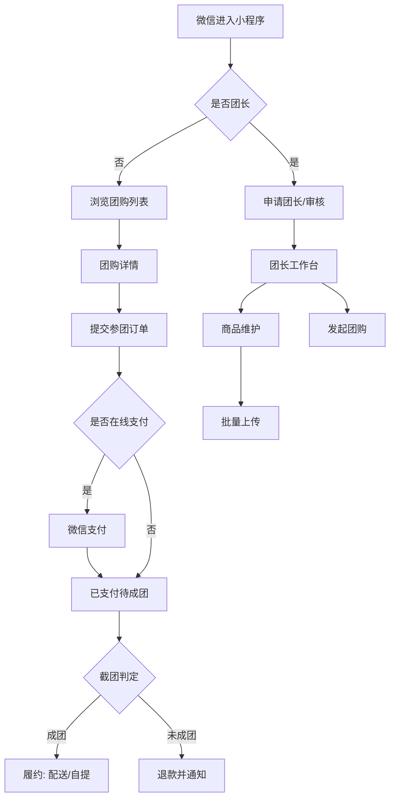

# PRD — 会员店代购小程序（SXX-2）

- 需求编号：SXX-2
- 版本：v0.2（草稿）
- 状态：**待人类确认**（未确认前不作为需求真源驱动 S1）
- 日期：2026-10-14
- 起草：DevSquad-Product
- 技术栈约束（来自需求方，已确定）：前端 原生微信小程序；服务端 JDK 17 + Spring Boot + Maven；数据库 MySQL。

> ⚠️ 本文档中凡标注 **【待确认】** 的条目均为**未定口径**，只列待选项、**不做假设**，未经确认不得作为实现依据。汇总见 §7 待确认清单。
> 文中出现的「建议值」仅用于在人类确认后支撑 S1 数据建模占位，**确认前不具备真源效力**。

---

## 1. 背景与目标

### 1.1 背景

山姆、盒马等会员制商超商品具备「大包装、高性价比」特点，但存在会员门槛、单次购买量大、门店距离远等摩擦，单个用户难以独立消化。社区/社群场景下通常由一名**团长**集中收集需求、统一到店采购并分发。

本产品以微信小程序承载这一流程：团长维护可售商品并组织团购，用户在同一小程序内浏览并参团，替代当前依赖微信群接龙、人工记账、线下收款的方式。

### 1.2 目标

| 编号 | 目标 | 说明 |
|---|---|---|
| G-1 | 团长可自助维护商品目录 | 支持单条维护与**批量上传**，替代手工逐条录入 |
| G-2 | 用户可自助参团 | 浏览在售团购、下单、查看订单与履约状态，无需人工登记 |
| G-3 | 团购过程状态可追溯 | 参团进度、成团/未成团、履约状态对用户与团长双向可见 |
| G-4 | 资金与结算口径清晰 | 付款、退款、服务费、团长结算有明确规则与记录 |

### 1.3 成功指标

【待确认】需求方未给出量化指标。建议口径（待确认）：
- 团长完成一次「批量上传 N 个 SKU」的耗时 ≤ X 分钟
- 用户从进入小程序到下单成功 ≤ X 步
- 团购成团率 ≥ X%

> 指标数值属业务口径，**不假设**，由人类补。

---

## 2. 范围

### 2.1 In scope（本版做）

- 微信小程序端：用户浏览团购、参团下单、订单查看（对应 FR-6 / FR-7 / FR-9）
- 团长侧：商品目录维护、批量上传、团购活动管理（对应 FR-3 / FR-4 / FR-5）
- 服务端：用户/团长/商品/团购/订单领域接口（JDK17 + Spring Boot + Maven）
- 数据层：MySQL 持久化
- 权限：用户与团长两类角色的区分与访问控制（边界待确认，见 Q-02）

### 2.2 Out of scope（本版明确不做）

| 编号 | 不做的内容 | 原因 |
|---|---|---|
| OOS-1 | 平台自营商品/自营采购 | 业务定位为代购撮合，平台不持货 |
| OOS-2 | 多商户商城、购物车跨团合并下单 | 本版以「一商品一团」为主，跨团购物车不做 |
| OOS-3 | 会员店官方系统对接（山姆/盒马 API、自动下单、库存/价格同步） | 无官方开放能力，本版由团长人工录入价格与库存 |
| OOS-4 | 团长端 Web 管理后台 | 待确认（见 Q-01）；若确认需要，另立需求 |
| OOS-5 | 即时通讯/客服会话 | 本版不做聊天，仅做状态通知 |
| OOS-6 | 分销/多级团长、团长邀请裂变 | 层级关系与结算复杂，待确认后再议 |
| OOS-7 | 售后退换货（签收后） | 生鲜/会员店商品售后规则待确认，本版仅覆盖「未成团退款」 |
| OOS-8 | 数据看板/经营分析 | 非本版目标 |

---

## 3. 功能需求（FR）

### FR-1 身份与登录

用户与团长进入小程序后需具备可识别身份。

- FR-1.1 小程序需获取用户微信身份标识（openid）以建立账号。
- FR-1.2 账号区分「用户」「团长」两类角色；同一微信账号是否可同时具备两种角色 【待确认 Q-03】。
- FR-1.3 是否强制微信授权手机号 【待确认 Q-04】——影响下单与配送联系方式采集。

### FR-2 团长入驻

团长需经一定流程获得团长身份后方可维护商品与开团。

- FR-2.1 提供团长入驻申请入口，采集申请信息（字段集 【待确认 Q-05】）。
- FR-2.2 入驻是否需要平台审核 【待确认 Q-06】：若需审核，申请后为「待审核」态，审核通过方可使用团长功能；审核不通过需给出原因。
- FR-2.3 团长账号是否可被平台停用/冻结 【待确认 Q-07】。

### FR-3 商品维护（单条）

团长维护自己可售的商品目录。

- FR-3.1 团长可新增商品，录入字段集 【待确认 Q-08】（建议至少含：商品名称、来源门店、规格、单价、图片、库存/限量、上下架状态）。
- FR-3.2 团长可编辑、上下架、删除自己创建的商品。
- FR-3.3 商品列表支持按名称/来源门店/状态筛选与分页。
- FR-3.4 商品价格与库存由团长人工维护，不与会员店官方系统同步（见 OOS-3）。

### FR-4 商品批量上传

团长通过模板文件批量导入商品。

- FR-4.1 提供标准导入模板下载（模板字段集 【待确认 Q-08】；文件格式 【待确认 Q-09】：xlsx / csv）。
- FR-4.2 团长上传文件后系统进行校验：必填缺失、格式错误、数值非法、重复商品。
- FR-4.3 校验结果需逐行反馈：成功条数、失败条数、失败行号与原因，并支持下载失败明细。
- FR-4.4 导入行为语义 【待确认 Q-10】：仅新增 / 新增+按某键更新 / 覆盖式全量替换。
- FR-4.5 单次导入条数上限与文件大小上限 【待确认 Q-11】。

### FR-5 团购活动管理（团长发起）

团长基于商品发起团购。

- FR-5.1 团长可对一个商品发起团购，设定起团量、截团时间、团购价 【待确认 Q-12 / Q-13 / Q-14】。
- FR-5.2 团购状态至少包含：未开始 / 进行中（可参团）/ 已截团待判定 / 已成团 / 未成团已取消 【待确认 Q-15】。
- FR-5.3 达到截团时间或达到起团量时触发成团判定，判定规则 【待确认 Q-13】。
- FR-5.4 团长可查看参团名单与分项汇总（商品、数量、金额、联系方式可见性 【待确认 Q-16】）。

### FR-6 用户浏览与参团

- FR-6.1 用户可浏览进行中的团购列表，含商品图、名称、规格、团购价、已参团量/起团量进度、截团剩余时间。
- FR-6.2 用户可查看团购详情（商品描述、价格、起团量、截团时间、配送/自提方式 【待确认 Q-17】）。
- FR-6.3 用户可提交参团订单，选择数量并填写必要信息（字段随配送方式变化）。
- FR-6.4 用户可查看自己的订单列表与订单详情（状态随团购状态流转）。
- FR-6.5 用户在截团前是否可取消/修改订单 【待确认 Q-18】。

### FR-7 支付

- FR-7.1 参团是否需要在线支付 【待确认 Q-19】：在线预付 / 线下收款 / 货到付款。
- FR-7.2 若在线支付，走微信支付（小程序支付），涉及微信商户号资质 【待确认 Q-19】。
- FR-7.3 支付成功与团购未成团的资金处理见 FR-8。

### FR-8 成团判定与未成团处理

- FR-8.1 截团后按判定规则得出「已成团」或「未成团」。
- FR-8.2 未成团时，已支付订单需退款，退款范围与时限 【待确认 Q-20】。
- FR-8.3 未成团需通知到用户，通知渠道 【待确认 Q-21】。

### FR-9 履约：配送 / 自提

- FR-9.1 订单履约方式 【待确认 Q-17】：团长配送 / 用户自提 / 两者都支持并按团设定 / 快递发货。
- FR-9.2 配送运费规则（是否收费、起送门槛）【待确认 Q-22】。
- FR-9.3 自提点信息由团长维护，字段与是否允许多个自提点 【待确认 Q-23】。
- FR-9.4 履约状态流转（待配货 / 配送中 / 已送达 / 已自提）【待确认 Q-24】。

### FR-10 服务费与团长结算

- FR-10.1 平台是否向团长/用户收取服务费 【待确认 Q-25】。
- FR-10.2 若收费，计费基数与费率 【待确认 Q-25】。
- FR-10.3 团长结算周期与方式 【待确认 Q-26】。
- FR-10.4 结算记录需可查（团长侧）。

### FR-11 通知

- FR-11.1 关键状态变更需触达用户：成团、未成团、发货/可自提。
- FR-11.2 通知渠道与是否必需订阅消息 【待确认 Q-21】。

### FR-12 权限边界

- FR-12.1 用户不能访问团长功能（商品维护、批量上传、开团、参团名单）。
- FR-12.2 团长之间数据隔离范围 【待确认 Q-27】：团长是否只能看自己的商品/团/订单。
- FR-12.3 团长是否可作为普通用户参团（含其他团长的团）【待确认 Q-28】。
- FR-12.4 是否存在平台运营/管理员角色及其入口 【待确认 Q-29】。

### FR-13 团购列表模糊搜索

用户可在团购列表页输入关键词，对团购做模糊匹配检索（新增需求，来源：SXX-2 评论 01a139d4-8b2d）。

- FR-13.1 团购列表页提供搜索入口（顶部搜索框），输入关键词后对列表做模糊匹配。
- FR-13.2 搜索字段范围 【待确认 Q-33】：候选字段为商品名 / 团标题 / 团长昵称 / 来源店铺（门店）/ 商品说明。
- FR-13.3 匹配方式 【待确认 Q-34】：子串包含（`LIKE '%kw%'`）/ 中文分词匹配 / 拼音（全拼或首字母）匹配 / 以上组合。
- FR-13.4 与筛选的关系：搜索与状态筛选为「与」关系（先筛后搜），两者可同时生效。
- FR-13.5 与排序的关系 【待确认 Q-36】：默认排序及是否允许用户在搜索态下改排序。
- FR-13.6 与分页的关系：关键词作为分页参数透传；新搜索从第 1 页开始；翻页期间关键词不变。
- FR-13.7 输入体验：输入防抖时长 【待确认 Q-37】；最小触发长度 【待确认 Q-38】。
- FR-13.8 文本归一化：英文大小写不敏感；全角 / 半角、中英文空格处理规则 【待确认 Q-39】。
- FR-13.9 结果为空时展示「无匹配」态，与「列表本身为空」态区分；提供清空关键词回到全量列表。
- FR-13.10 结果规模与检索能力上限 【待确认 Q-40】：结果条数上限，以及是否需引入 MySQL 全文索引 / 外部搜索引擎。
- FR-13.11 搜索仅作用于用户可见范围内的在售团购，不得因搜索扩大数据可见性（权限边界与 FR-12 一致）。
- FR-13.12 团长端（商品列表 / 团购管理）是否同样需要搜索 【待确认 Q-41】。

---

## 4. 验收标准（AC）

> AC 中凡涉及 【待确认】 口径的项，在口径确认前**不可判定**；确认后由 Product 回流更新本文档。

### FR-1 身份与登录
- AC-1.1 同一微信用户重复进入小程序，账号不重复创建（可复现验证：连续进入 3 次，账号数 = 1）。
- AC-1.2 用户身份调用团长接口返回拒绝（403），团长身份调用团长接口正常。
- AC-1.3 【待确认 Q-04】若要求手机号，未授权手机号时下单流程给出明确阻断提示，不静默失败。

### FR-2 团长入驻
- AC-2.1 提交入驻申请后申请记录落库，申请人在申请列表可见。
- AC-2.2 【待确认 Q-06】若需审核：审核前团长功能入口不可进入；审核状态变更后入口权限同步变化（不要求重新登录即可生效，或明确要求重新登录——待确认）。
- AC-2.3 审核不通过时申请人可看到不通过原因。

### FR-3 商品维护
- AC-3.1 新增商品后可在商品列表查到，字段与录入一致。
- AC-3.2 下架商品不出现在用户端团购列表；已参团的历史订单不受影响。
- AC-3.3 编辑价格不影响已生效团购的价格（历史价格快照行为需明确，【待确认 Q-30】）。
- AC-3.4 筛选条件（名称/门店/状态）组合查询结果正确，分页无重复与遗漏。

### FR-4 批量上传
- AC-4.1 下载得到的模板文件字段与文档约定字段一致。
- AC-4.2 上传合法文件：全部行成功导入，返回成功条数正确，列表可查到全部导入商品。
- AC-4.3 上传含非法行的文件：返回成功/失败条数，失败行给出行号与具体原因；失败行不入库。
- AC-4.4 空文件、非约定格式文件、超出大小/条数上限的文件被拒绝并给出明确错误提示，不产生部分脏数据。
- AC-4.5 【待确认 Q-10】重复导入同一文件的行为符合确认的语义（幂等/覆盖/报错），验证方式随之确定。

### FR-5 团购管理
- AC-5.1 开团参数（起团量、截团时间、团购价）落库且与设定一致。
- AC-5.2 团购状态随时间/参团量按确认规则流转，状态流转可复现（构造数据验证）。
- AC-5.3 截团后不再接受新订单。
- AC-5.4 参团名单包含全部有效订单，汇总数量与金额与订单明细一致（对账校验）。

### FR-6 浏览与参团
- AC-6.1 团购列表展示的进度与剩余时间与服务端计算一致（前后端一致，误差口径待确认）。
- AC-6.2 参团数量超库存/超限量时被拒绝并提示。
- AC-6.3 截团后下单请求被拒绝并提示「已截团」。
- AC-6.4 订单详情展示的状态与服务端状态一致。

### FR-7 支付
- AC-7.1 【待确认 Q-19】若在线支付：支付成功订单转为已支付；支付超时/取消不产生有效订单。
- AC-7.2 支付金额与商品单价 × 数量 + 运费（若有）一致。
- AC-7.3 支付回调重复到达不产生重复订单、不重复记账（幂等）。

### FR-8 成团与退款
- AC-8.1 未成团时全部已支付订单进入退款流程，状态对用户可见。
- AC-8.2 退款金额与实付金额一致（含运费是否退——【待确认 Q-31】）。
- AC-8.3 退款重试/部分失败可被发现（有失败记录，不静默丢失）。

### FR-9 履约
- AC-9.1 履约方式随团长设定展示给用户，用户不可选择团长未提供的线下方式。
- AC-9.2 需配送的订单必须含有效收货信息；缺信息时下单被阻断。
- AC-9.3 履约状态变更后用户端同步可见。

### FR-10 结算
- AC-10.1 【待确认 Q-25/Q-26】若收服务费，按确认基数与费率计算，金额可核对（给出计算示例）。
- AC-10.2 团长侧结算记录与订单明细可对账。

### FR-11 通知
- AC-11.1 成团/未成团/可自提事件触发后，通知在确认时限内触达。
- AC-11.2 通知失败不阻断主流程，且不重试风暴（重试策略待确认）。

### FR-12 权限
- AC-12.1 用户调用任意团长接口被拒绝（服务端强制校验，非仅前端隐藏）。
- AC-12.2 【待确认 Q-27】团长 A 不能查询/修改团长 B 的商品与订单（服务端校验）。
- AC-12.3 越权尝试被记录（日志），不返回越权数据。

### FR-13 模糊搜索
- AC-13.1 关键词命中商品名子串时，结果包含该团购；未命中项不出现（构造 ≥5 条数据验证）。
- AC-13.2 【待确认 Q-33】若确认纳入团长昵称 / 来源店铺，输入对应关键词同样命中。
- AC-13.3 大小写不敏感：输入 `MM` 与 `mm` 返回结果一致。
- AC-13.4 【待确认 Q-39】全角/半角等价：输入含全角数字与半角数字返回结果一致。
- AC-13.5 关键词长度小于最小触发长度时不发起请求（以服务端访问日志/请求抓包验证），列表保持原样不闪空。
- AC-13.6 连续快速输入 N 个字符，实际发起请求次数 ≤ 预期值（防抖生效），且最终展示结果与最后一次输入一致（无乱序响应覆盖，请求需按序取消或按序丢弃）。
- AC-13.7 搜索无结果时展示「无匹配」态并回显关键词与清空入口；**不得**展示「暂无进行中的团购」空态。
- AC-13.8 搜索态下切换筛选/排序，关键词保留；清空关键词后回到全量列表第 1 页。
- AC-13.9 搜索结果翻页：第 1、2 页之间无重复、无遗漏（同一关键词 + 同一排序下连续两次请求结果集稳定）。
- AC-13.10 关键词含 `%` `_` `'` `"` `<` 等元字符时不报错、不返回越权数据（参数化查询 / 转义），页面正常展示无匹配或结果。
- AC-13.11 已下架商品、已截团归档项、他团数据不因搜索出现在结果中（与 AC-12.1 一致）。
- AC-13.12 搜索接口响应时间满足约定阈值（阈值 【待确认 Q-40】，建议 P95 ≤ 500ms @ 1 万条团购量级）。

---

## 5. 设计说明

### 5.1 平台与形态

- 用户端：**微信小程序（原生）**，移动端优先。
- 团长端形态 **【待确认 Q-01】**：(a) 同一小程序内团长入口；(b) 独立 Web 管理后台；(c) 先小程序、后续补 Web。
  - 说明：Q-01 影响「批量上传」的交互形态（小程序内文件上传能力受限，Web 后台更适配批量场景）。mockup 按 (a) 方案出图，若确认为 (b) 需重出团长端 mockup。
- 桌面/平板响应式：小程序运行于移动端，**桌面与平板档不适用**；若 Q-01 确认为 Web 后台，需补充 ≥1280px 与 768–1279px 两档。

### 5.2 交互流程

### 5.3 页面清单与状态

| 页面 | 归属 | 必须覆盖状态 |
|---|---|---|
| P-1 登录/角色入口 | 双端 | 默认、加载、授权拒绝、网络异常 |
| P-2 团购列表 | 用户 | 默认（含搜索框）、加载、空、错误、已截团项置灰、**输入中（防抖）、搜索有结果、搜索无匹配** |
| P-3 团购详情 | 用户 | 默认、加载、已截团、已达起团量、售罄/超库存 |
| P-4 参团下单 | 用户 | 默认、校验错误、超量、提交中、成功、失败 |
| P-5 我的订单/详情 | 用户 | 默认、空、加载、各订单状态、退款中/已退款 |
| P-6 团长入驻申请 | 团长 | 默认、校验错误、提交中、待审核、通过、不通过 |
| P-7 商品列表 | 团长 | 默认、加载、空、筛选无结果、上下架切换 |
| P-8 商品编辑/新增 | 团长 | 默认、校验错误、保存中、成功 |
| P-9 批量上传 | 团长 | 模板下载、选择文件、上传中、成功、部分失败（含失败明细）、全部失败 |
| P-10 团购管理 | 团长 | 默认、空、进行中、已截团待判定、已成团、未成团 |
| P-11 参团名单 | 团长 | 默认、空、加载、导出（若需要，待确认） |

### 5.4 mockup 链接

- 相对路径：`docs/mockups/index.html`（与本文档同仓提交；本次因仓库 checkout 不可用，先以附件形式随 SXX-2 交付）
- 原型覆盖上述 P-1 ~ P-11 全部页面，移动端 375px 基准；含全状态与键盘/对比度可访问性处理说明。

### 5.5 可访问性与设计约束

- 正文对比度 ≥ 4.5:1，关键操作按钮对比度 ≥ 3:1。
- 不依赖颜色单独传达状态（状态文案 + 图标 + 颜色三重编码）。
- 点击区域 ≥ 44×44px。
- 尊重 `prefers-reduced-motion`。
- 无设计规范/Design Token：**不自造体系**，本版采用微信小程序原生基础组件与标准语义色（成功绿/警示橙/错误红），品牌色 【待确认 Q-32】。

---

## 6. 变更日志

| 版本 | 日期 | 变更点 | 原因 | 触发来源 | 确认人 |
|---|---|---|---|---|---|
| v0.1 | 2026-10-14 | 首版起草：SXX-2 需求受理，产出六段结构 PRD 与 mockup；全部业务口径标为【待确认】 | 需求方原始需求 + TechLead S0 派单 | Multica issue SXX-2（评论 01a139ca） | **待人类确认** |
| v0.2 | 2026-10-14 | 新增 **FR-13 团购列表模糊搜索** 与 AC-13.1~AC-13.12；新增待确认项 Q-33~Q-41；mockup P-2 补「搜索框 / 输入中（防抖）/ 搜索有结果 / 无匹配」四态；§9 更新 B-1（checkout retry 成功）、B-2（路径以派单为准，冲突点留 Reviewer 记一条） | 人类提出新需求「团购列表需要支持模糊搜索」；按「PRD 为唯一需求真源」走修订而非口头加需求 | SXX-2 评论 01a139d4-8b2d（人类）+ 01a139d5（TechLead 派单） | **待人类确认** |

---

## 7. 待确认清单（业务口径）

> 全部为未定口径，仅列待选项，**不做假设**。建议值一栏为「若无人拍板时的建模占位建议」，**不等于决策**。

| 编号 | 议题 | 待选项 | 建议值（待确认） | 阻塞级别 |
|---|---|---|---|---|
| Q-01 | 团长端形态 | (a) 同一小程序团长入口 (b) 独立 Web 后台 (c) 先小程序后补 Web | (a) | **P0**（影响交互与 mockup） |
| Q-02 | 用户/团长权限边界总口径 | 严格两角色互斥 / 一账号双身份可切换 | 一账号双身份 | P1 |
| Q-03 | 同一微信可否兼用户与团长 | 可以 / 不可以 | 可以（Q-02 联动） | P1 |
| Q-04 | 是否强制微信手机号授权 | 强制 / 仅下单时按需 / 不需要 | 下单时按需 | P1 |
| Q-05 | 团长入驻申请字段 | 姓名、手机号、门店/采购渠道、常驻社区、身份证明材料… | 姓名+手机号+常驻社区 | P1 |
| Q-06 | 入驻是否需平台审核 | 需审核 / 自助开通 / 邀请码开通 | 需审核 | **P0**（影响角色状态机） |
| Q-07 | 团长可否被停用 | 可 / 不可 | 可 | P2 |
| Q-08 | 商品字段集 + 批量上传模板字段 | 名称/门店/规格/单价/团购价/库存/图片URL/条码/单位/分类… | 名称、来源门店、规格、单价、库存、图片URL | **P0**（影响表结构） |
| Q-09 | 模板文件格式 | xlsx / csv / 两者 | xlsx | P1 |
| Q-10 | 导入语义 | 仅新增 / 新增+按键更新 / 全量覆盖 | 新增+按「商品编码」更新 | **P0**（影响幂等设计） |
| Q-11 | 单次导入上限 | 条数 / 文件大小 | 1000 条 / 5MB | P2 |
| Q-12 | 起团量定义与是否必填 | 必填 / 可为 0（不设门槛） | 必填 | **P0** |
| Q-13 | 成团判定规则 | 截团时达量即成 / 达量即成且提前截团 / 仅按时间截团判定 | 截团时达量即成 | **P0**（影响状态机与定时任务） |
| Q-14 | 截团时间粒度与是否可延长 | 固定时间点 / 可延长 | 固定时间点，可延长一次 | P1 |
| Q-15 | 团购状态集 | 见 FR-5.2 五态 / 增补「已取消」 | 五态 + 团长手动取消 | P1 |
| Q-16 | 团长可见的用户信息范围 | 昵称+手机号 / 仅昵称 / 昵称+手机号后四位 | 昵称+手机号 | P1（涉及隐私合规） |
| Q-17 | 履约方式 | 团长配送 / 用户自提 / 两者按团设定 / 快递 | 两者按团设定 | **P0**（影响履约模型） |
| Q-18 | 截团前可否取消/改单 | 可 / 不可 / 仅未支付可取消 | 未支付可取消 | P1 |
| Q-19 | 是否必需在线支付（微信支付） | 必需在线预付 / 线下收款 / 货到付款 / 混合 | 必需在线预付 | **P0**（涉及商户资质与合规，周期最长） |
| Q-20 | 未成团退款时限与范围 | 自动全额退 / 人工触发 / 退商品不退运费 | 自动全额退 | **P0** |
| Q-21 | 通知渠道 | 微信订阅消息 / 短信 / 仅小程序内消息 | 微信订阅消息 | P1（依赖 Q-19 与资质） |
| Q-22 | 配送运费 | 免费 / 固定运费 / 满额免运 | 满额免运（门槛待定） | P1 |
| Q-23 | 自提点 | 单自提点 / 多自提点 / 团长维护 | 单自提点，团长维护 | P2 |
| Q-24 | 履约状态集 | 待配货/配送中/已送达/已自提 | 同左 | P1 |
| Q-25 | 服务费 | 不收 / 按订单金额比例 / 固定每单 | 待定（合规敏感，需人类定） | **P0**（资金流） |
| Q-26 | 团长结算周期与方式 | 按单即时 / 按周 / 按月 / 手动提现 | 待定 | **P0**（资金流） |
| Q-27 | 团长间数据隔离 | 完全隔离 / 平台管理员可跨团长查看 | 完全隔离 | P1 |
| Q-28 | 团长可否参团（含他团） | 可以 / 不可以 | 可以 | P2 |
| Q-29 | 是否有平台管理员角色 | 有（含后台入口）/ 无（直接改库） | 有 | P1 |
| Q-30 | 改价是否影响已开团 | 不影响（价格快照）/ 影响 | 不影响 | P1 |
| Q-31 | 未成团时运费是否退 | 退 / 不退 | 退 | P1 |
| Q-32 | 品牌主色 | — | 待人类给值 | P2 |
| Q-33 | 搜索字段范围 | 仅商品名 / +团标题 / +团长昵称 / +来源店铺 / +商品说明 | 商品名 + 团标题 + 店铺 | P1 |
| Q-34 | 匹配方式 | 子串 LIKE / 中文分词 / 拼音全拼 / 拼音首字母 / 组合 | 子串 LIKE（`%kw%`） | P1（选分词或拼音则引入新组件，需单独上抛） |
| Q-35 | 搜索与筛选的优先级 | 先筛后搜（与关系）/ 搜索忽略筛选 | 先筛后搜 | P2 |
| Q-36 | 搜索态排序 | 默认按截团时间 / 按相关度 / 允许用户切换 | 默认截团时间，允许切换 | P1 |
| Q-37 | 输入防抖时长 | 200ms / 300ms / 500ms / 失焦或回车触发 | 300ms | P2 |
| Q-38 | 最小触发长度 | 1 字即搜 / 2 字 / 不做限制 | 2 字 | P1 |
| Q-39 | 全角半角与空格归一化 | 仅大小写归一 / +全半角归一 / +去空格与标点 | 大小写 + 全半角归一 | P1 |
| Q-40 | 结果上限与检索能力 | 仅 LIKE / MySQL 全文索引 / 引入 Elasticsearch；结果条数上限 | 先 LIKE + 商品名索引；量级上万后再评估 | P1（引入 ES 则属架构变更，需单独上抛） |
| Q-41 | 团长端是否也要搜索 | 同用户端 / 仅商品列表 / 不需要 | 商品列表需要 | P2 |

### 7.1 P0 阻塞项（需人类拍板）

以下 11 项不拍板则 S1 无法完成数据建模与状态机设计，需人类（xiangxiu.shen）决策：**Q-01、Q-06、Q-08、Q-10、Q-12、Q-13、Q-17、Q-19、Q-20、Q-25、Q-26**。

> 说明：P0 项中 **Q-19（微信支付）** 涉及微信商户号申请与小程序类目资质，外部依赖周期最长，建议优先拍板；**Q-25/Q-26（服务费与结算）** 涉及资金与合规，不建议由小队代定。
>
> **v0.2 补充**：FR-13 模糊搜索的新增**不改变上列原 P0 清单**，搜索相关项（Q-33 ~ Q-41）一律定级 P1/P2。其中 **Q-34 若选择中文分词或拼音匹配**、**Q-40 若引入外部搜索引擎**，属于新增组件/架构变更，需单独上抛人类，不由本 PRD 代定。

---

## 8. 交付与入库状态（本版）

| 项 | 状态 |
|---|---|
| PRD 起草 | 完成（本文档，v0.2） |
| mockup | 完成（`docs/mockups/index.html`，含 FR-13 搜索态） |
| Reviewer `prd-critic` | 待 TechLead 一次性派单（v0.2 出齐后） |
| 人类确认（门禁） | **未确认** |
| 入 Git 仓库 | 已完成提交到分支 `agent/devsquad-product/fb95cfb65da8`（base `main`） |
| S1 启动 | 门禁未过，**不启动** |

## 9. 阻塞与风险（交付侧）

| 编号 | 事项 | 详情 | 处理建议 |
|---|---|---|---|
| B-1 | ~~仓库 checkout 不可用~~ | v0.1 时报错 `exec: "git": executable file not found in $PATH`（daemon 侧 PATH 抖动）；**v0.2 retry 已成功**，基于 `main` 建分支 `agent/devsquad-product/fb95cfb65da8`。 | 已恢复入库通道；若后续再次出现 PATH 抖动，继续走附件交付，不阻塞。 |
| B-2 | 目标路径口径冲突 | TechLead 派单指定 `docs/PRD.md` + `docs/mockups/index.html`；团队 `prd-management` 约定为 `docs/prd/<需求id>/PRD.md`。**TechLead 已裁决：本次以派单为准**，冲突点转交 Reviewer 记一条。 | 本次按 `docs/PRD.md` / `docs/mockups/index.html` 交付；后续是否回归团队约定由 Reviewer/人类定。 |
| B-3 | 团长端形态（Q-01） | 影响 mockup 与前端工作量 | 人类拍板 |
| B-4 | 微信支付资质（Q-19） | 涉及商户号与类目，周期不可控 | 人类优先拍板 |
